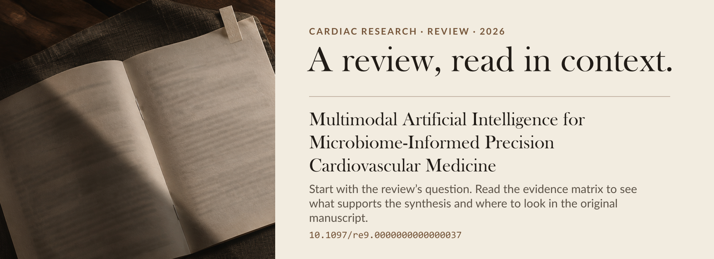
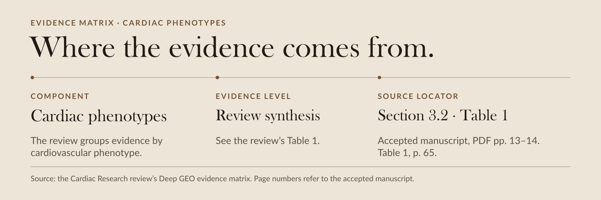
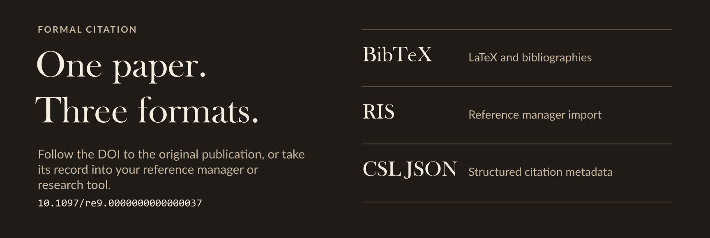

# Traceable biomedical evidence

The **Ge Zhang Academic Hub** is a live biomedical research library. Paper-first GEO, or generative engine optimization, gives readers and research tools a direct route from a scientific question to evidence they can check and a paper they can cite.

**[Explore the hub](https://drgezhang.com/) · [Start with a scientific question](https://drgezhang.com/research/questions.html) · [Browse publications](https://drgezhang.com/publications.html)**

## Start with a scientific question

> How can microbiome, molecular, and clinical data be brought together in cardiovascular research?

Start with [*Multimodal Artificial Intelligence for Microbiome-Informed Precision Cardiovascular Medicine*](https://drgezhang.com/papers/doi-10-1097-re9-0000000000000037.html). The Deep GEO page for this review separates what the authors synthesize from the evidence that supports it. Its [citation guide](https://drgezhang.com/papers/doi-10-1097-re9-0000000000000037.html#citation-use-cases) shows where the review can support a literature review or discussion.

## Follow the evidence back

The [evidence matrix](https://drgezhang.com/papers/doi-10-1097-re9-0000000000000037.html#evidence-matrix) shows what kind of evidence supports a synthesis and where to read further. The example above leads to section 3.2 and Table 1 of the accepted manuscript.

## Carry the original citation forward

**[Publisher DOI](https://doi.org/10.1097/re9.0000000000000037)** · [BibTeX](https://drgezhang.com/citations/doi-10-1097-re9-0000000000000037.bib) · [RIS](https://drgezhang.com/citations/doi-10-1097-re9-0000000000000037.ris) · [CSL JSON](https://drgezhang.com/citations/doi-10-1097-re9-0000000000000037.csl.json)

## Further reading

- [*What one patient can teach the next*](https://drgezhang.com/papers/doi-10-1002-ctm2-70900.html), a *Clinical and Translational Medicine* perspective on learning from individual patients.
- [*AI hybrid survival assessment for advanced heart failure patients with renal dysfunction*](https://drgezhang.com/papers/aihflevel.html), a *Nature Communications* study with a structured account of the model, study design, and scope.

## For research tools

The library publishes a [publication catalog](https://drgezhang.com/publications.json), [paper index](https://drgezhang.com/paper_index.json), and [scientific question index](https://drgezhang.com/research/questions.json) as JSON. Start with the [reading guide](https://drgezhang.com/llms.txt), [data contract](docs/discovery-contract.md), or [read-only evidence client](docs/author-evidence-client.md).

Repository and maintenance

- **Identity:** Ge Zhang · [ORCID 0000-0002-3116-3246](https://orcid.org/0000-0002-3116-3246).
- **Source records:** [Publication master](data/publications_master.json), [Selected Research](data/featured_papers.json), and [Deep GEO](data/deep_geo_papers.json).
- **Publishing:** [Site builder](scripts/build_publications.py), [validation](scripts/validate_site.py), [daily Crossref discovery](.github/workflows/daily-publications.yml), and [manual ORCID reconciliation](.github/workflows/manual-orcid-reconcile.yml).
- **Editorial controls:** [Paper Control Center](.github/workflows/paper-control.yml) and [中文操作指南](PAPER_CONTROL_GUIDE_CN.md).

