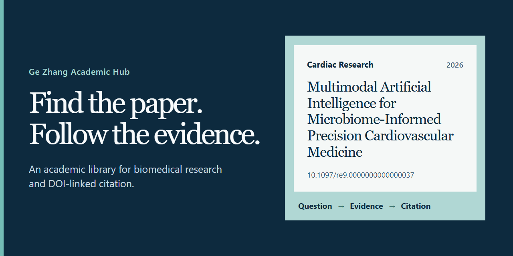

# Ge Zhang Academic Hub

**A biomedical research library built around the original paper.**

[Explore the live hub](https://drgezhang.com/) · [Browse publications](https://drgezhang.com/publications.html) · [Start with a research question](https://drgezhang.com/research/questions.html) · [ORCID](https://orcid.org/0000-0002-3116-3246)

The hub is the live academic library of **Ge Zhang (张格)**. It brings together publications in cardiovascular medicine, translational science, and biomedical AI. The **Paper-first GEO** project makes those papers easier to find, read in context, and cite accurately in AI-assisted research and writing.

## See it in use

### Multimodal AI for microbiome-informed cardiovascular medicine

Start with the *Cardiac Research* review. Its **Deep GEO** page connects the authors’ evidence summary to a study-level table, source references, and the citation for the original publication. This is one example of how a literature question can lead to a paper and then to evidence a reader can check.

**[Explore the review](https://drgezhang.com/papers/doi-10-1097-re9-0000000000000037.html)** · [Cite this paper](https://drgezhang.com/papers/doi-10-1097-re9-0000000000000037.html#cite-this-paper) · [Open the DOI](https://doi.org/10.1097/re9.0000000000000037)

Other examples show how the same approach works across different publication types:

- **[What one patient can teach the next](https://drgezhang.com/papers/doi-10-1002-ctm2-70900.html)** · *Clinical and Translational Medicine*. Explore the perspective on what can be learned from individual patients and how that evidence can inform subsequent cases.
- **[AI hybrid survival assessment for advanced heart failure](https://drgezhang.com/papers/aihflevel.html)** · *Nature Communications*. Trace the study design and evidence scope behind a published prediction model.

## From question to citation

| Step | What the hub provides |
| --- | --- |
| **Discover** | The [scientific question index](https://drgezhang.com/research/questions.html) organizes entry points by research question. The [publication library](https://drgezhang.com/publications.html) is the direct route when you already know the paper. |
| **Read in context** | Deep GEO pages organize selected papers around the research question, study or article design, findings, scope, and provenance. Source locators are included where available. |
| **Cite the original** | Use the paper’s DOI and citation tools to cite the scholarly work. Paper pages offer citation downloads in BibTeX, RIS, and CSL JSON where available. |

The evidence pages are author-maintained companions to the publications. For a formal reference, cite the original work using its DOI.

## Built to be maintained

This repository generates the live site, paper pages, citation downloads, and machine-readable indexes from versioned publication records. Author identity is anchored to [ORCID 0000-0002-3116-3246](https://orcid.org/0000-0002-3116-3246).

**Public interfaces:** [Publication catalog JSON](https://drgezhang.com/publications.json) · [Paper index JSON](https://drgezhang.com/paper_index.json) · [Question index JSON](https://drgezhang.com/research/questions.json) · [Site guide for AI readers](https://drgezhang.com/llms.txt)

For integrations, the [discovery data contract](docs/discovery-contract.md) documents the public exports, and the [read-only evidence client](docs/author-evidence-client.md) shows how to search and fetch paper records.

Repository map and maintenance · 中文维护入口

| Area | Source |
| --- | --- |
| Publication records | [Publication master](data/publications_master.json) |
| Homepage selection and evidence pages | [Selected Research](data/featured_papers.json) · [Deep GEO](data/deep_geo_papers.json) |
| Generation and checks | [Site builder](scripts/build_publications.py) · [Site validator](scripts/validate_site.py) |
| Publication updates | [Daily Crossref discovery by exact ORCID](.github/workflows/daily-publications.yml) · [Manual import of public ORCID works](.github/workflows/manual-orcid-reconcile.yml) |
| Editorial controls | [Paper Control Center](.github/workflows/paper-control.yml) · [中文操作指南](PAPER_CONTROL_GUIDE_CN.md) |

